<p align="center">
  
</p>

<p align="center">
  
  
  
  
  
  
  
</p>

<p align="center">
  <b>Gold moves on trust. Tarazu makes it move on proof, and gives the weaker side the same book.</b><br>
  <sub>Hackathon build · PS 2.2 Agentic AI · <i>tarazu</i> (तराज़ू) means "balance scale"</sub>
</p>

---

## The problem

In India's jewellery trade, a jeweller hands raw gold to a **karigar** (artisan) for job-work. Weeks later finished
jewellery, scrap and an agreed amount of process loss come back. Only the jeweller keeps the record. The karigar
often cannot read it, cannot check it, and has no proof when the numbers disagree or labour pay is late.
A 0.27 g gap on one job is a week's wages for him and a dispute that ends a working relationship.

## What Tarazu does

**Tarazu is one notebook that both sides sign.** Each gold movement is spoken aloud, read back, and counted only once
**both** the karigar and the jeweller have signed it. Entries are chained by hash, so a changed number shows up
straight away. Agents look for gaps and propose fixes, but people make every decision.

| | For the karigar | For the jeweller |
|---|---|---|
| **Record** | Press the green mic and speak: *"आज 250 ग्राम 22 कैरेट सोना मिला"*. Tara reads it back and he says **हाँ** or **नहीं** | Countersign queue: nothing counts until both have signed |
| **See** | "Your gold" in big numbers and 10 g coins, in his own language, read aloud | Every karigar, every job, a Day Seal QR for the day's book |
| **Disagree** | Red **"my count is different"** button; the divergence finder pinpoints the exact entry | Proposed correction at the fair median; settlement needs both signatures |
| **Get paid** | Payment clock on every delivered job | Deadline Guardian warns before a wedding order slips |
| **Grow** | Consent-based **Trust Passport** he can show a lender | Customer tracking without exposing weights |

## Screenshots

<table>
  <tr>
    <td colspan="3">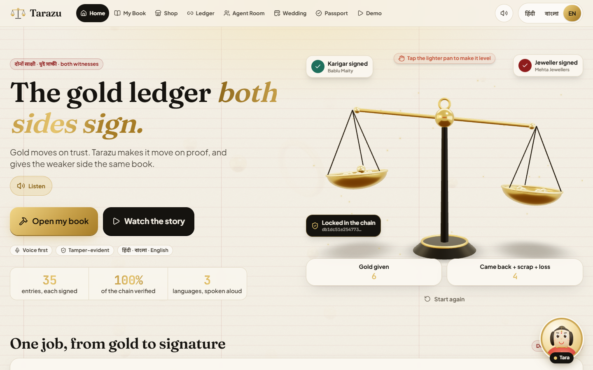</td>
  </tr>
  <tr>
    <td width="33%">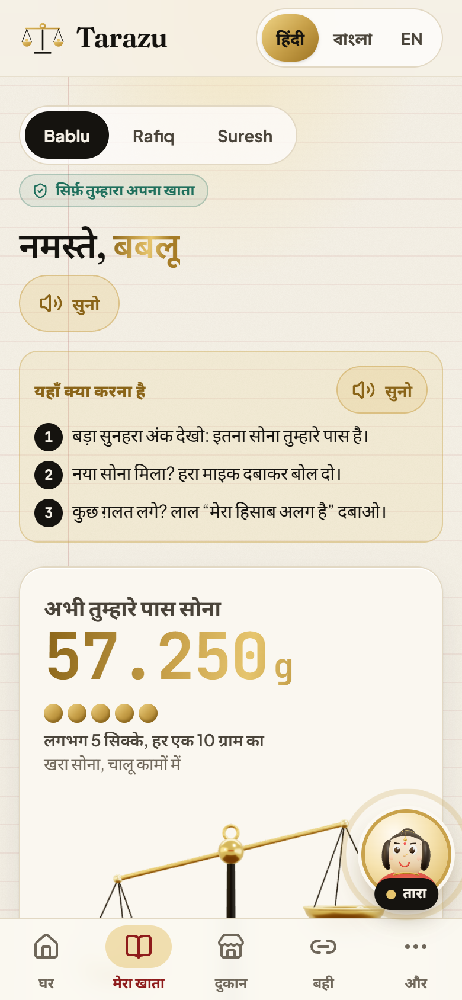<br><sub><b>My Book</b>, in Hindi: gold shown as coins, a Listen button on everything</sub></td>
    <td width="33%">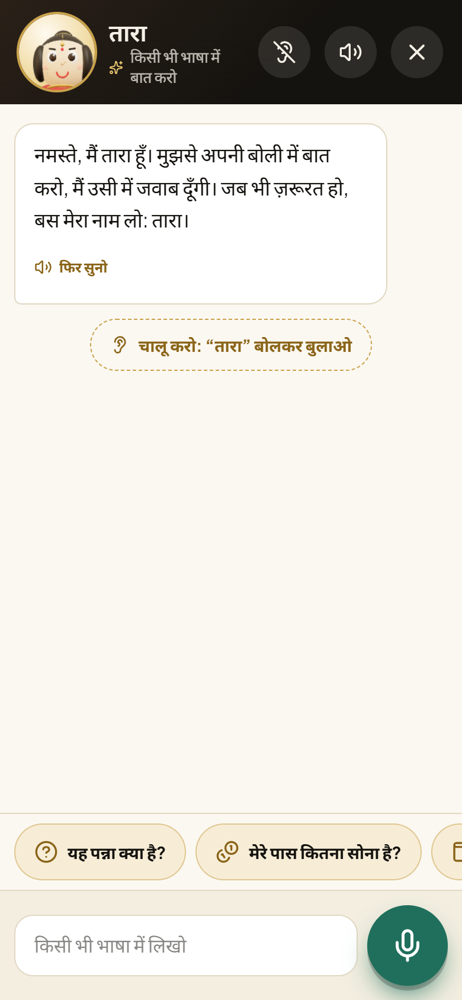<br><sub><b>Tara</b>, the voice helper: replies in whatever language you speak, and comes when you say "Tara"</sub></td>
    <td width="33%">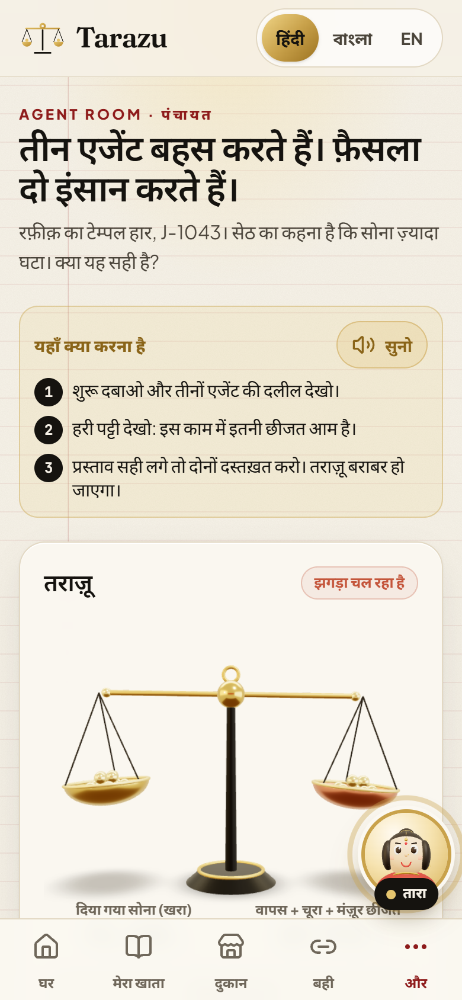<br><sub><b>Agent Room</b>: three agents argue from the numbers; humans sign</sub></td>
  </tr>
</table>

<details>
<summary><b>More screens (desktop)</b></summary>

| Shop (jeweller) | Ledger |
|---|---|
| 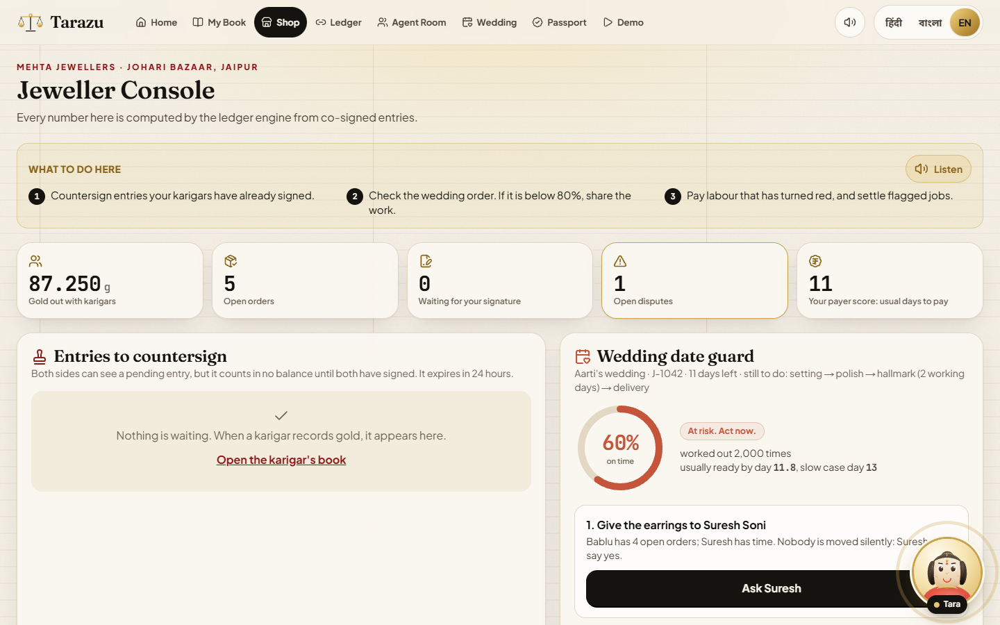 | 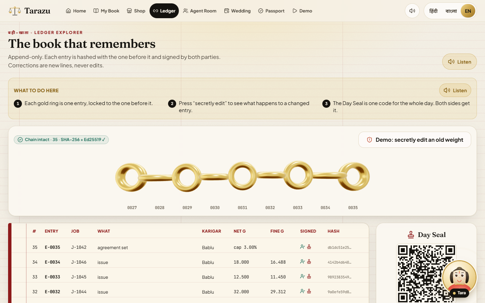 |
| **Agent Room** | **Trust Passport** |
| 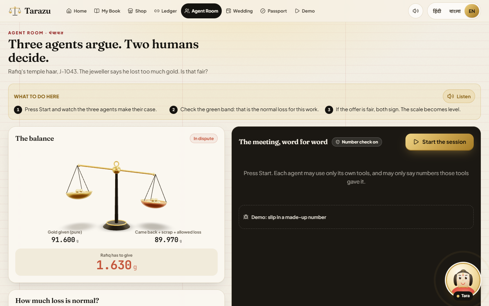 | 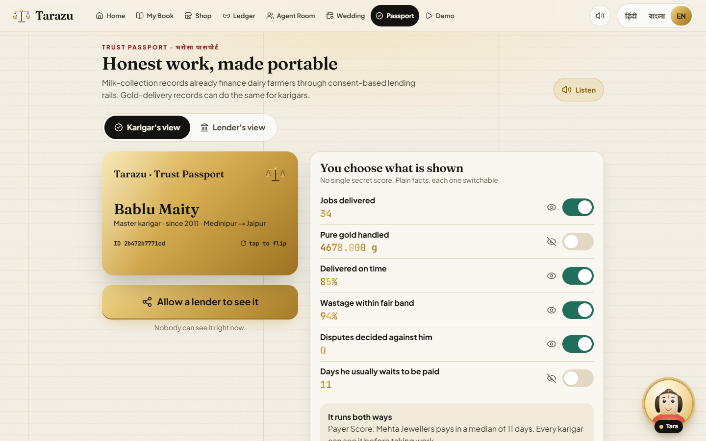 |
| **My Book (karigar)** | **Demo film** |
| 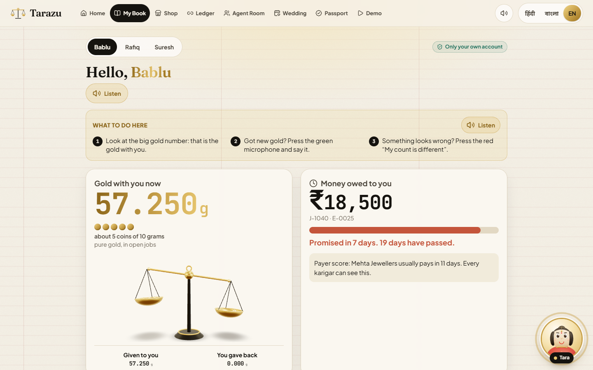 | 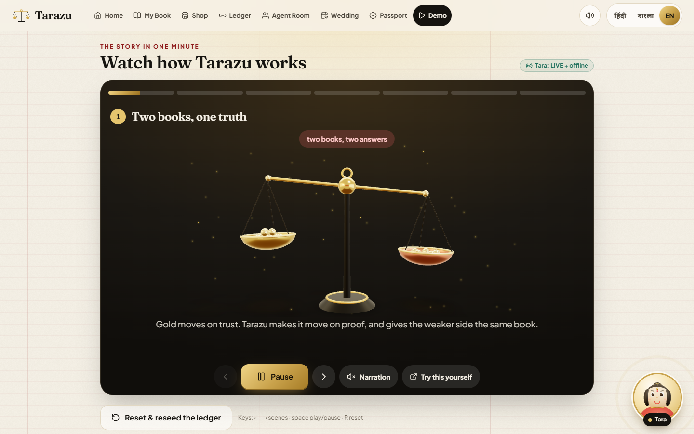 |

</details>

---

## How it works

### One entry, from voice to the chain

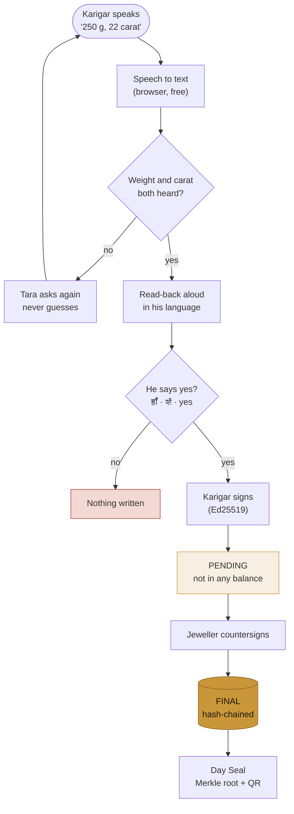

### Life of a ledger event

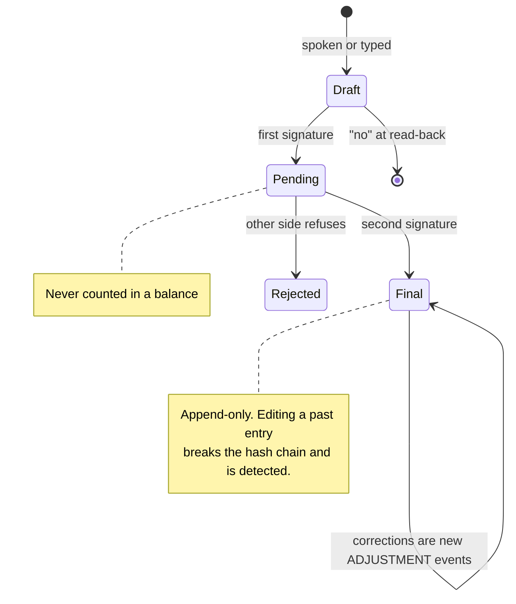

### When the counts disagree

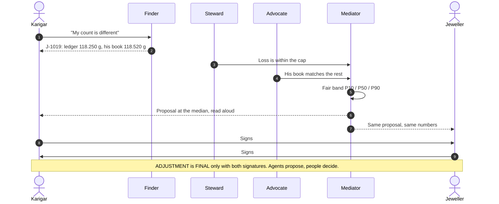

### Architecture

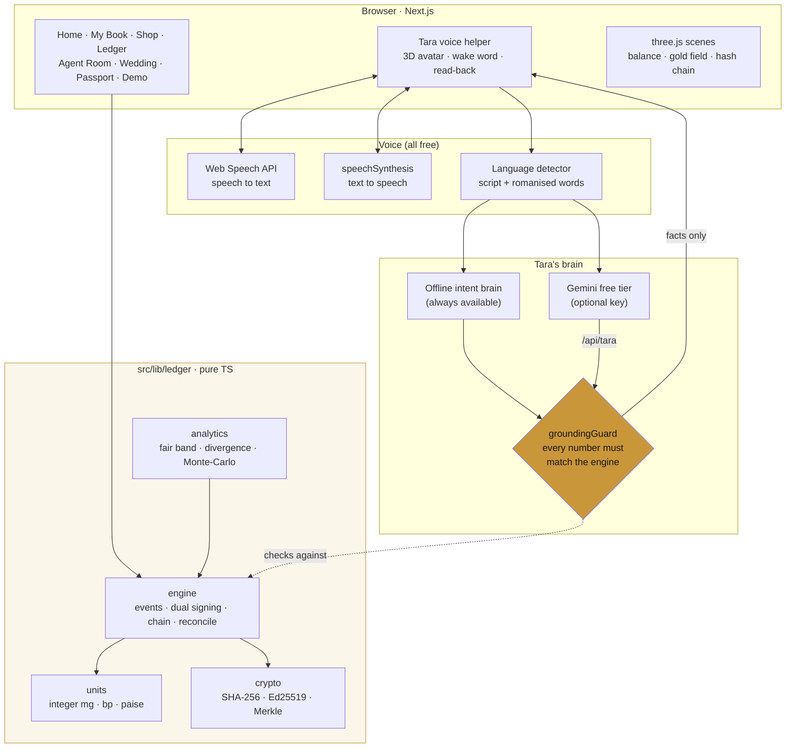

---

## Rules the code keeps

| Rule | Where it is enforced |
|---|---|
| **Models never do arithmetic or move value.** Every number comes from the engine; anything a model says passes `groundingGuard` | `src/lib/ledger/analytics.ts`, `src/app/api/tara/route.ts` |
| **Integers only**: milligrams, basis points, paise. Rounding is half-up (`mulBp`) | `src/lib/ledger/units.ts` |
| **Append-only.** Corrections are new `ADJUSTMENT` events | `src/lib/ledger/engine.ts` |
| **Two signatures or it is not FINAL.** Legacy imports are single-signed and flagged | `finalize()` in `engine.ts` |
| **Pending never counts** in a balance | `holdingFine()` |
| **A karigar sees only his own account** | `visibleTo()` |
| **No paid APIs.** Browser speech; Gemini only if you add a free key | `.env.example` |
| **Never invent facts.** Demo values are labelled; tax notes say "verify with a CA" | UI copy |

## Built for someone who may not read

- **Listen** button on everything he must understand; an optional **read every screen to me** mode
- Read-back before every signature, then a big green **yes** and red **no**, which he can also just say aloud
- Everyday words: "your gold", not "fine weight"; jewellery names in Hindi and Bengali so the voice says them properly
- Gold shown as a row of 10 g coins as well as a number
- Tap targets of 48 px or more, Lucide icons with labels, works at 360 px wide
- **Tara**: say *"Tara, मेरा पैसा कब मिलेगा?"* from any screen. She answers in the language you used, opens the right page, and responds to "say it again" and "speak slowly"

---

## Run it

```bash
git clone https://github.com/Piyush5525/Tarazu.git
cd Tarazu
npm install
npm run dev          # http://localhost:3000
```

| Command | What it does |
|---|---|
| `npm run dev` | Development server on port 3000 |
| `npm test` | Ledger tests: golden scenarios A–E, tamper detection, isolation, 1,000-run conservation property, grounding guard |
| `npm run build` then `npm start` | Production build |
| `npm run typecheck` | TypeScript check |

**No key is needed.** Voice works best in Chrome or Edge (desktop or Android). To let Tara answer open questions, copy
`.env.example` to `.env` and add a free [Google AI Studio](https://aistudio.google.com/) key:

```env
DEMO_MODE=true
GEMINI_API_KEY=            # optional, free tier
GEMINI_MODEL=gemini-3.5-flash-lite
```

Without a key, or if the free tier is busy, Tara falls back to her offline brain automatically.

## A 3-minute demo

Open **`/demo`** for an animated seven-scene film with optional narration, or follow the path by hand:

1. **My Book** → press the mic, say *"आज 250 ग्राम 22 कैरेट सोना मिला, हार के लिए"* → read-back → say **हाँ**
2. **Shop** → countersign it → seal the day (QR)
3. **My Book** → "my count is different" → divergence on **J-1019**: 118.250 g vs 118.520 g → **0.247 g** fine gold
4. **Shop** → the wedding order has a **60%** chance of finishing in time → Suresh takes half → **92%**
5. **Agent Room** → three agents, a fair band, a settlement both people sign
6. **Ledger** → tamper with an entry → the chain breaks and shows where → restore
7. **Passport** → share with consent → the lender view verifies it

## Project layout

```
src/
├─ app/                 pages: / karigar jeweller ledger agents track passport demo
│  └─ api/tara/         Gemini proxy (key stays on the server), structured JSON, model fallback
├─ components/
│  ├─ Shell.tsx         header, phone tab bar, onboarding, read-to-me
│  ├─ Tara.tsx          voice helper: 3D avatar, wake word, chat
│  └─ three/            Balance3D, GoldField, Chain3D, TaraAvatar
└─ lib/
   ├─ ledger/           units · crypto · engine · analytics · seed   (pure, tested)
   ├─ voice.ts ear.ts   speech in and out, language detection, wake word
   ├─ tara.ts           offline brain, page help, chips
   ├─ i18n.ts           en / hi / bn
   └─ store.ts          app state (zustand)
tests/ledger.test.ts
```

## What is real and what is staged

**Real:**
- Integer ledger, SHA-256 hash chain, Ed25519 signatures, Merkle Day Seal
- Divergence finder, fair band computed from history, seeded Monte-Carlo
- Grounding guard, voice in and out, language detection

**Staged:**
- Karigars, jobs and 120 past jobs are seeded demo data
- Keys are demo keys held in the browser
- No database or real identity behind the screens

See [`ASSUMPTIONS.md`](ASSUMPTIONS.md) and [`PROGRESS.md`](PROGRESS.md).

## Roadmap

- [ ] Supabase with row-level security and server-held keys
- [ ] Real model agents with tool allow-lists behind the Agent Room
- [ ] Photo OCR of the karigar's own notebook
- [ ] Audit-pack PDF, WhatsApp share, refiner intake

---

<p align="center"><sub>Built for the karigars whose hands make the jewellery, and whose word should count as much as the seth's.</sub></p>
